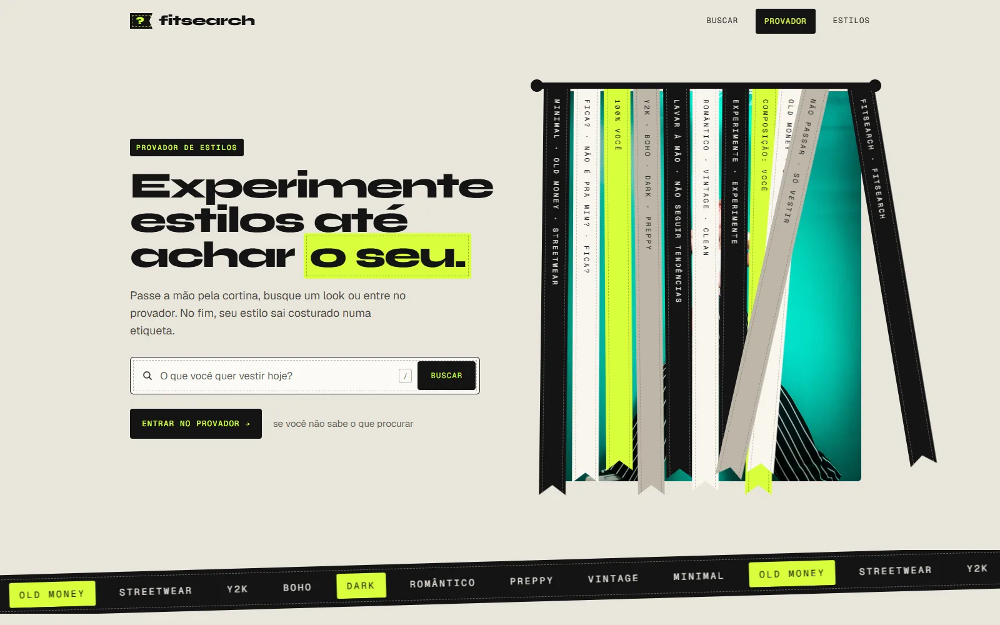
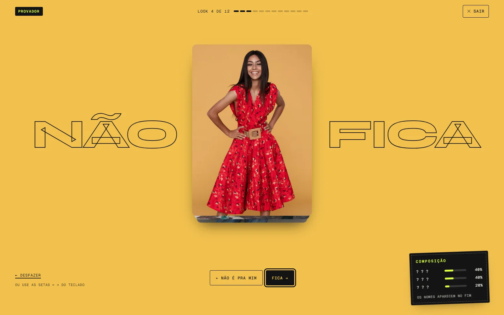

# FitSearch

Um app de moda: buscador de roupas com um provador de estilos. Você experimenta looks, diz se fica ou não e sai com o seu estilo costurado numa etiqueta. Feito para quem se sente perdido no mundo da moda.



## O que dá para fazer

- **Buscar** peças e looks, com sugestões enquanto você digita.
- **Filtrar a arara** por público (todos, feminino, masculino), por estilo e por ocasião.
- **Entrar no provador:** um quiz visual em que você responde "Fica" ou "Não é pra mim" para cada look e sai com a sua etiqueta de estilo.
- **Conhecer os 9 estilos:** Minimal, Old Money, Streetwear, Y2K, Boho, Dark, Romântico, Preppy e Vintage. Cada um tem peças-chave e uma dica de por onde começar.
- A etiqueta fica guardada no navegador, para a próxima visita.

O catálogo tem 36 looks, 4 por estilo. As fotos são do Unsplash.

| Provador | Arara |
|---|---|
|  |  |

## Como abrir

Abra o `index.html` no navegador. É um site estático: não precisa de servidor nem de instalação.

## Testes

São 57 testes automatizados do motor de busca e recomendação, do catálogo e do armazenamento local:

```bash
node --test testes/*.test.js
```

Pede o Node 20 ou mais novo.

## Tecnologias

HTML, CSS e JavaScript puro. As animações usam GSAP (núcleo, Flip e ScrollTrigger).

## Estrutura

- `index.html`: a página.
- `css/`: tokens, base, componentes, seções e o provador.
- `js/motor.js`: busca e recomendação. `js/dados.js`: estilos e looks. `js/armazenamento.js`: a etiqueta salva no navegador.
- `js/ui/`: arara, busca, cortina, estilos, etiqueta, faixa, gaveta, provador e movimento.
- `testes/`: os testes, com o `node:test`.
- `docs/`: a especificação e o plano do redesign.

## Sobre

Redesign do VLOM.CUST, um recomendador de streetwear que fiz antes. Identidade visual, UX e código: **Washington Gabriel** ([GitHub](https://github.com/Washington-dev-fullstack)).
